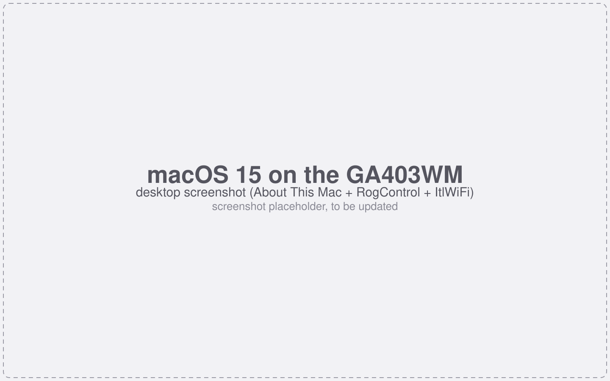
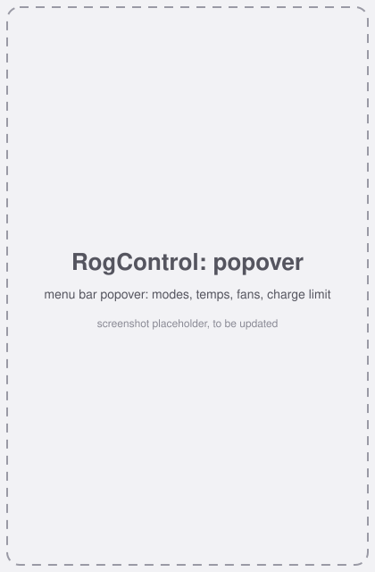
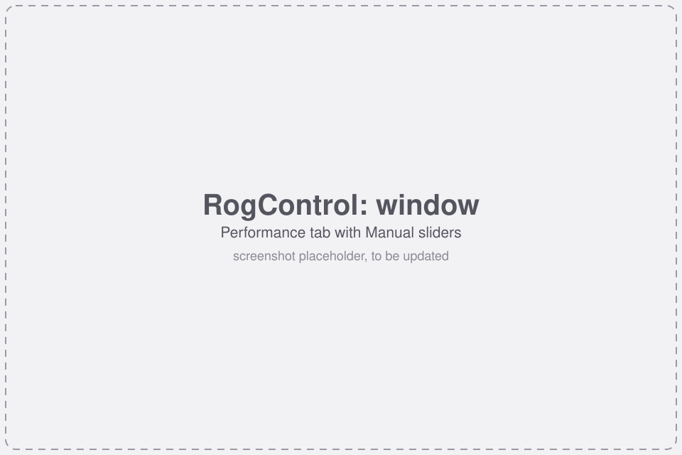
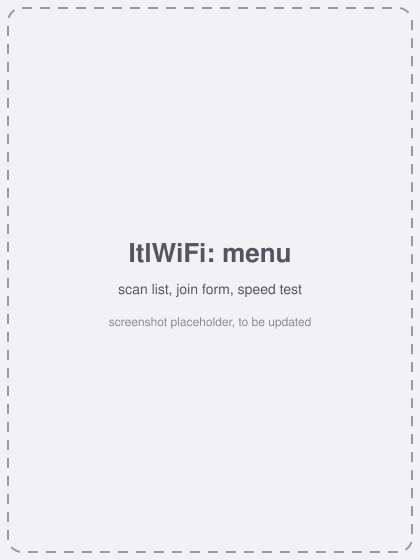
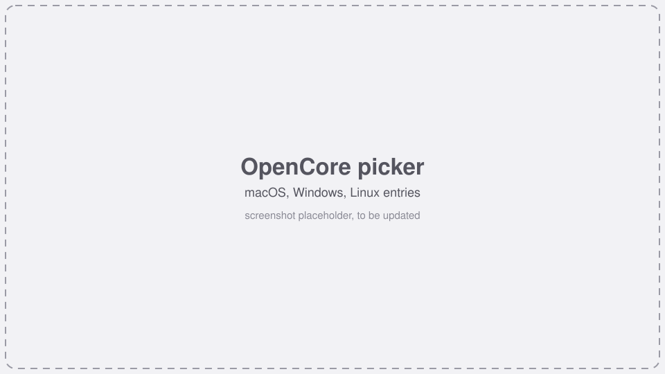
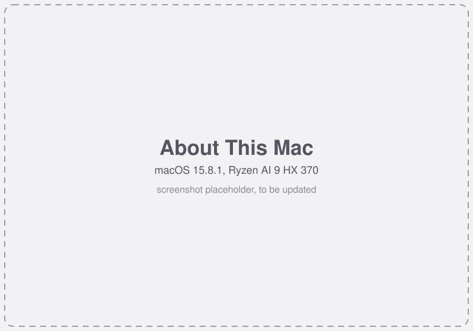
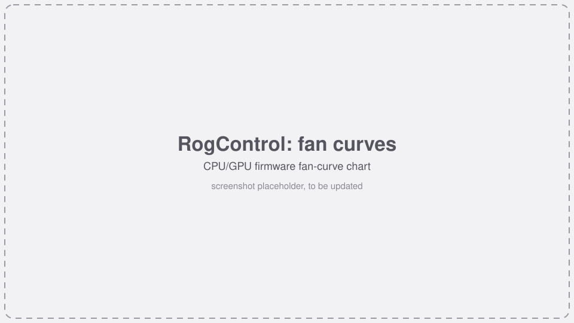

# ga403wm-hackintosh (Tiếng Việt)

**macOS trên ASUS ROG Zephyrus G14 (GA403WM, 2025): Ryzen AI 9 HX 370 "Strix Point" + RTX 5060 Laptop.**
EFI OpenCore, kext, app thanh menu và ghi chú nghiên cứu. English: [README.md](README.md).

<p align="center">
  
</p>

> ## ⚠️ Dự án "vibe-code". Đọc kỹ trước khi đụng vào máy.
>
> **Gần như toàn bộ mã và tài liệu ở đây do AI (Claude của Anthropic) viết**, do một người chỉ đạo và test trên **một** chiếc
> GA403WM. Chưa ai audit mã. Cụ thể:
>
> * Các kext (`itlmt7925`, `AsusWmi`, `AmdCppc`, `MtkBtFw`, ...) chạy **trong nhân macOS**. Lỗi = kernel panic, treo máy, tệ nhất là hỏng dữ liệu.
>   `AsusWmi` và `AmdCppc` ghi vào EC, BIOS (qua SMI) và thanh ghi CPU.
> * Driver Wi-Fi viết từ đầu và lưu mật khẩu Wi-Fi của bạn **dạng chữ thường** trong kext.
> * EFI và boot-args lấy từ dự án khác rồi chỉnh cho đến khi máy này boot được. Không được "gia cố" (SIP gần như tắt, AMFI nới lỏng, Secure Boot tắt).
> * Mọi thứ chạy được **trên máy tham chiếu**. Máy của bạn (BIOS khác, panel khác, SKU khác) có thể không chạy.
> * **Không bảo hành.** Brick máy, panic, mất dữ liệu, mất bảo hành là việc của bạn. Xem [LICENSE](LICENSE).
>
> Backup tất cả. Giữ USB cứu hộ Windows/Linux. Đừng cài lên máy không thể cài lại. Đừng dùng cho công việc không được phép mất.
> Hãy coi đây là dự án nghiên cứu, không phải sản phẩm.

## Tình trạng trong một phút

| | |
|---|---|
| macOS hỗ trợ | **macOS 15 Sequoia** duy nhất (phát triển trên 15.6.1, đang dùng hằng ngày trên **15.8.1**, build 24H32) |
| **macOS 26 Tahoe** | **Chưa hỗ trợ, chưa test.** Ở lại 15 cho đến khi 15 ổn định. Driver NVIDIA phụ thuộc chỉ dành cho macOS 15. Đừng nâng cấp. |
| Máy | ASUS ROG Zephyrus G14 **GA403WM**, BIOS GA403WM.310, OLED 2880x1800. Biến thể GA403 khác: chưa test |
| Boot | OpenCore 1.0.9 + bản vá Zen 5, từ ESP trong máy; Windows/Linux vẫn nằm trong picker OpenCore |
| Đồ họa | RTX 5060 qua [driver NullMoth](https://github.com/nullmoth/nvidia-macos-driver); **bắt buộc chế độ GPU "Ultimate" (MUX)**, iGPU không dùng được |
| Wi-Fi | Driver tự viết, hiện là **Ethernet** (en*), chậm; chưa có menu Wi-Fi gốc. Phải **inject SSID/mật khẩu** ([hướng dẫn](docs/INSTALL.vi.md#4-wi-fi-inject-mạng)) |
| Đang hỏng | Touchpad I2C (chết trên máy tham chiếu, chưa rõ nguyên nhân), chuột BLE (bản sửa chưa test). HiDPI chỉ chạy một cỡ |

Chú giải dùng xuyên suốt: ✅ đã kiểm chứng trên máy tham chiếu · 🟡 đã viết, cần test thêm · 🔧 đang làm ·
❌ không chạy · ⚪ chưa làm / chưa kiểm chứng.

## Cái gì chạy

| Mảng | Trạng thái | Ghi chú | Chi tiết |
|---|---|---|---|
| Boot macOS 15 từ ổ trong | ✅ | OpenCore 1.0.9 + `fix-zen5-fsb.diff` (timer chạy sớm ~10 lần trên Zen 5) | [efi/README.md](efi/README.md) |
| CPU (12 nhân / 24 luồng) | ✅ | `AmdCppc` + `AmdCppcPolicy` bật CPPC; nhân Zen 5 lên ~4,9 GHz khi tải (trước đó kẹt 2 GHz) | [docs/CPU-POWER.md](docs/CPU-POWER.md) |
| NVIDIA RTX 5060 + OLED 2880x1800 @ 120 Hz | ✅ | Driver bên thứ ba NullMoth 1.14.2 + hai bản vá cục bộ. Cần MUX = chỉ dGPU. Màn ngoài chạy được | [docs/NULLMOTH.md](docs/NULLMOTH.md) |
| Phím / chuột USB / webcam | ✅ | `ItlXhciKick` sửa lỗi nhả phím trễ 2 giây; port map USB nằm trong EFI chuẩn (sắp có, xem mục Cài đặt) | [docs/USB-XHCI-LAG.md](docs/USB-XHCI-LAG.md) |
| Wi-Fi MT7925 | 🟡 | WPA2-PSK, DHCP, link HE/160 MHz. Đo được chỉ **~5-40 Mb/s**; chưa có WPA3, 6 GHz; hiện là Ethernet | [docs/WIFI.md](docs/WIFI.md) |
| Bluetooth MT7925 | 🟡 | `MtkBtFw` nạp firmware; thiết bị classic (tai nghe) kết nối được. Chuột BLE: đã viết bản sửa, chưa test | [docs/BLUETOOTH.md](docs/BLUETOOTH.md) |
| Chế độ hiệu năng ROG, quạt, giới hạn sạc | 🟡 | `AsusWmi` + app RogControl. Silent/Performance/Turbo đổi xung nhịp và tốc độ quạt thật | [docs/ASUSCTL-MACOS.md](docs/ASUSCTL-MACOS.md) |
| Đèn bàn phím, đèn Slash | 🟡 | Qua `AsusWmi` (HID report gửi từ kernel) | [docs/ASUSCTL-MACOS.md](docs/ASUSCTL-MACOS.md) |
| Độ sáng OLED | 🔧 | Panel chỉ điều khiển qua AUX; `NVRMEdpBL` (DPCD) đã cài, chờ kiểm chứng. Có lớp phủ làm tối bằng phần mềm làm tạm | [docs/OLED-BRIGHTNESS-DPCD.md](docs/OLED-BRIGHTNESS-DPCD.md) |
| Sleep / wake | 🟡 | Một chu kỳ sleep/wake khôi phục được chính sách CPU; chưa test rộng | |
| Dual boot Windows / Linux | ✅ | Chọn từ picker OpenCore; có ghi chú sửa entry UEFI bị mất | [docs/DUAL-BOOT.md](docs/DUAL-BOOT.md) |
| Touchpad (I2C `093a:3011`) | ❌ | Chết trên máy tham chiếu (cả Windows) từ 2026-10-10; chưa tìm ra nguyên nhân. Chuột USB dùng được | [HANDOFF #1](docs/HANDOFF.md) |
| HiDPI "looks like 1440 x 900" @ 120 Hz | 🟡 | Chạy được trên máy tham chiếu nhờ file override màn hình; **các tỉ lệ khác bị đen màn hình** (driver không làm được mode co giãn) | [docs/SCRIPTS.vi.md §4](docs/SCRIPTS.vi.md#4-hidpi-looks-like-1440-x-900-từng-bước) |
| Âm thanh, đầu đọc thẻ SD, % pin, phím Fn khác ngoài độ sáng | ⚪ | Kext đã có trong EFI (AppleALC layout 33, Sinetek-rtsx, SMCBatteryManager) nhưng **chưa kiểm chứng** | |
| Wi-Fi gốc trong System Settings / AirDrop / Continuity | ⚪ | Cần port `IO80211Controller`; mới ở mức nghiên cứu | [docs/WIFI-AS-WIFI.md](docs/WIFI-AS-WIFI.md) |
| iGPU Radeon 890M | ❌ | Cố ý ẩn khỏi macOS; không có driver | |

Mọi dòng trong bảng đều có ngày tháng và bằng chứng trong [docs/HANDOFF.md](docs/HANDOFF.md) (sổ nhật ký, tiếng Anh).

## Ảnh chụp

Ảnh giữ chỗ, sẽ thay bằng ảnh thật. Danh sách ảnh cần chụp: [docs/images/README.md](docs/images/README.md).

| Popover RogControl | Cửa sổ RogControl | Menu ItlWiFi |
|---|---|---|
|  |  |  |

| Picker OpenCore | About This Mac | Đường cong quạt |
|---|---|---|
|  |  |  |

## Cài đặt

> 📦 **EFI chuẩn: sắp có.** EFI hoàn chỉnh đang chạy của tác giả (kèm USB port map thật và các thiết lập đã test) sẽ được **upload sau
> thành asset của GitHub release**, README này sẽ được cập nhật khi có. Trước đó, thư mục `efi/` và `EFI-reference.zip` trong release chỉ là
> bản *tham khảo đã làm sạch* (SMBIOS giữ chỗ, USB map giữ chỗ, boot-args debug): đủ để tự ghép EFI theo hướng dẫn, nhưng không phải bản đã test.

Hướng dẫn đầy đủ: **[docs/INSTALL.vi.md](docs/INSTALL.vi.md)** (English: [docs/INSTALL.md](docs/INSTALL.md)). Tóm tắt:

1. BIOS: MUX = **Ultimate**, Above 4G Decoding **ON**, CSM **OFF**, Secure Boot **OFF**. Backup ổ đĩa.
2. Tải **[release v1 build sẵn](https://github.com/thanhnndev/ga403wm-hackintosh/releases)** (kext, app, daemon CPU, OpenCore đã vá, EFI tham khảo, checksum; hoặc
   `bash scripts/build.sh` trên Mac) cộng các kext bên thứ ba trong [efi/KEXTS.md](efi/KEXTS.md). Cách dùng release và mọi script:
   **[docs/SCRIPTS.vi.md](docs/SCRIPTS.vi.md)** (English: [SCRIPTS.md](docs/SCRIPTS.md)).
3. Ghép EFI từ [efi/](efi/README.md), **tự tạo SMBIOS**, thêm OpenCore đã vá.
4. **Inject mạng Wi-Fi** vào `itlmt7925.kext` (chưa có UI Wi-Fi gốc) hoặc dùng USB tethering.
5. Cài macOS 15 (nên dùng bộ cài offline: bộ cài online nặng 16 GB mà Wi-Fi của mình chậm), rồi cài driver NVIDIA, các app và daemon CPU.

## Thành phần

Từng kext, app: làm gì, đến đâu rồi: **[docs/COMPONENTS.md](docs/COMPONENTS.md)** (tiếng Anh).

| Thành phần | Một dòng | Trạng thái |
|---|---|---|
| `itlmt7925.kext` | Driver Wi-Fi MT7925 | 🟡 chạy, chậm, hiện là Ethernet |
| `ItlXhciKick.kext` | Sửa lỗi USB trễ trên xHCI AMD | ✅ |
| `AsusWmi.kext` | ASUS WMI/EC/HID: profile, quạt, giới hạn sạc, đèn nền, Slash | 🟡 |
| `AmdCppc.kext` + `AmdCppcPolicy` | Điều khiển boost/EPP CPU + daemon | ✅ / 🟡 |
| `MtkBtFw.kext` | Nạp firmware Bluetooth MT7925 | 🟡 |
| `BtLeDlFix.kext` | Plugin Lilu cho chuột BLE | 🟡 chưa test |
| `NVRMEdpBL.kext` (trong fork NullMoth) | Độ sáng OLED qua eDP AUX | 🔧 |
| `ItlDiag.kext` | chẩn đoán lúc boot | công cụ debug |
| **ROG Control** (`RogControl.app`) | thanh menu + cửa sổ: profile, quạt, sạc, đèn, làm tối | 🟡 |
| **ItlWiFi** (`ItlWiFi.app`) | Wi-Fi trên thanh menu: quét, kết nối, speed test | 🟡 |
| **TapGuard** (`TapGuard.app`) | bỏ qua tap touchpad khi đang gõ | 🟡 (touchpad thì ❌) |

### ROG Control làm được gì

* Chọn chế độ **Silent / Performance / Turbo / Manual** (Turbo tắt khi dùng pin, như Armoury Crate); Manual chỉnh SPL / SPPT / FPPT.
* Nhiệt độ CPU (Tctl), công suất package (RAPL), tốc độ quạt CPU/GPU, **đường cong quạt** của firmware (biểu đồ CPU/GPU).
* **Giới hạn sạc** 60 / 80 / 100 %, thông tin pin; cài đặt riêng cho AC và pin, tự áp lại khi đổi nguồn và sau khi đăng nhập.
* **Đèn bàn phím** và **đèn Slash** (độ sáng, chế độ), gửi lại sau khi wake.
* Làm tối OLED bằng phần mềm (tạm thời), trạng thái GPU MUX (chỉ đọc), `--bench` đo hiệu năng từng profile.
* Chưa có: đổi GPU MUX (cố ý chỉ đọc), hiệu ứng Aura từng phím, overdrive panel (BIOS này không có).

## Roadmap

**[docs/ROADMAP.md](docs/ROADMAP.md)** liệt kê từng hạng mục: đang làm gì, ở nhánh nào, bước kế tiếp. Điểm chính:

* 🔧 Tăng tốc Wi-Fi, sau đó **Wi-Fi gốc** (`IO80211Controller`) để menu bar và System Settings hoạt động
* 🔧 Độ sáng OLED qua DPCD, mượt hơn cho desktop (WindowServer CPU, VRAM clear)
* ❌ → ⚪ touchpad, chuột BLE; HiDPI ngoài 1440 x 900
* ⚪ kiểm chứng âm thanh / SD / pin, bản release đầu tiên có kext build bằng CI
* ⚪ **Chuẩn hoá codebase** (hàm dùng chung, dọn code debug, script): từng thành phần một, chỉ sau khi thành phần đó chứng minh ổn định
* ⚪ **macOS 26**: chỉ sau khi 15 ổn định. Chưa lên kế hoạch.

## Cấu trúc repo

```
efi/                 config.plist OpenCore đã làm sạch + SSDT, danh sách kext bên thứ ba (KEXTS.md, kexts.json)
kexts/               itlmt7925, ItlXhciKick, AsusWmi, AmdCppc, MtkBtFw, BtLeDlFix, ItlDiag
macos/               RogControl, ItlWiFi, TapGuard (app Swift), AmdCppcPolicy (launch daemon)
fw/                  firmware MediaTek MT7925 (linux-firmware) kèm license
patches/opencore/    bản vá OpenCorePkg cho Zen 5
scripts/             build, cài đặt, inject Wi-Fi, thu log, export EFI + kiểm tra riêng tư
tools/               công cụ đọc kernel collection, thăm dò HiDPI / frame pacing / xung CPU
test/                test trên host (WPA2, capabilities, Block Ack, ...), chạy trong CI
docs/                hướng dẫn cài, hướng dẫn script (có HiDPI), thành phần, roadmap, ghi chú nghiên cứu, HANDOFF (sổ nhật ký)
```

## Riêng tư

* Repo không chứa mật khẩu Wi-Fi hay định danh SMBIOS: `Info.plist` để trống `itl_ssid*/itl_psk*`, `efi/OC/config.plist` chỉ có
  giá trị giữ chỗ `CHANGE_ME_*`, CI sẽ fail nếu lộ giá trị thật. Kext **bạn** đã inject mật khẩu thì chứa mật khẩu dạng chữ thường: đừng chia sẻ.
* Log chứa địa chỉ MAC của card và SSID/BSSID xung quanh. Che trước khi đăng issue.

## Đóng góp, ghi công, giấy phép

* Báo cáo từ các chủ GA403WM khác là thứ giá trị nhất: mở issue bằng mẫu **Hardware report** và đọc [CONTRIBUTING.md](CONTRIBUTING.md).
* Dự án đứng trên công sức của người khác: [NullMoth](https://github.com/nullmoth/1401) (nền EFI và driver NVIDIA), Acidanthera
  (OpenCore, Lilu, VirtualSMC, AppleALC, ...), các dự án Linux `mt76`, `btmtk`, `asus-wmi`, `asusctl` (tham khảo thiết kế). Danh sách và giấy phép: [NOTICE.md](NOTICE.md).
* Mã: [Clear BSD License](LICENSE) (dựa trên driver Linux `mt76`, BSD-3-Clause-Clear, © MediaTek). Firmware trong `fw/`: [license của MediaTek](fw/LICENCE.mediatek).
  `efi/` dẫn xuất từ `nullmoth/1401` (PolyForm Noncommercial 1.0.0), **không** thuộc Clear BSD: chỉ dùng phi thương mại.
* Không liên kết với ASUS, Apple, NVIDIA, MediaTek, AMD hay NullMoth. Bạn tự chịu trách nhiệm tuân thủ điều khoản giấy phép macOS của Apple.
